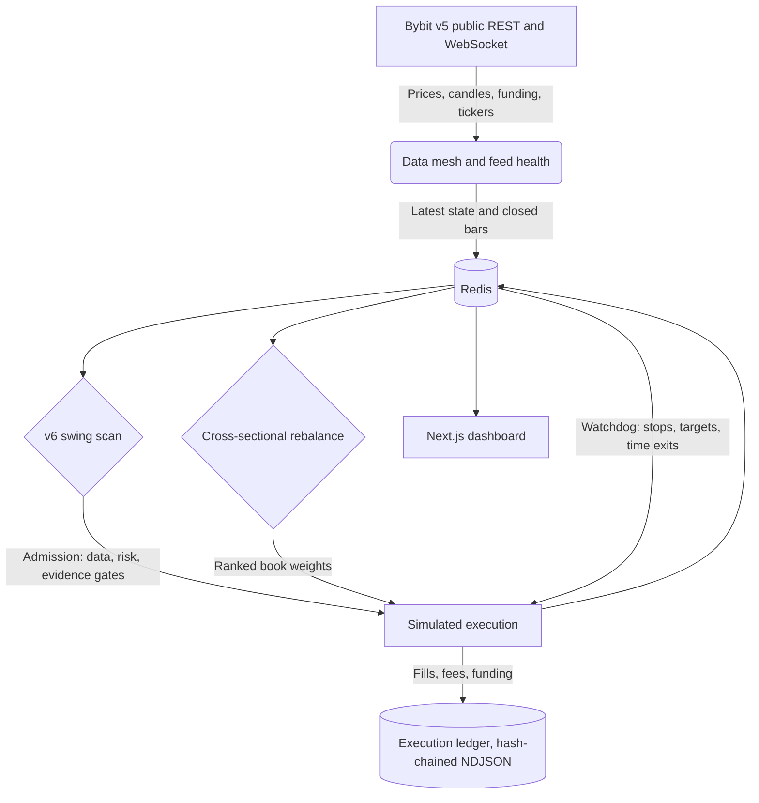

# Autonomous Paper Trading Agent

> **Autonomous multi-asset paper-trading system with deterministic signals, explicit risk gates, and a hash-chained execution ledger.**

A paper-only trading simulator that watches live public market data, proposes entries only after data-freshness and risk checks, simulates fills and fees, manages exits, and records why each decision was made. It is a research and demonstration project. It places no real orders, needs no exchange keys, and is not a trading service.

**Demo video:** not yet produced | **Author:** [Tejas Hendre](https://www.tejashendre.com/)

---

## 1. What it does

The system runs two independent simulated accounts, each with its own ledger, and a dashboard that shows both.

| Engine | Process | What it trades | Cadence |
|---|---|---|---|
| **v6 swing "brain"** | `src/daemon/replacementSwingDaemon.ts` | Nine assets: BTC, ETH, SOL, EUR/USD, GBP/USD, USD/JPY, Gold, Crude Oil (WTI), Silver | Entry scan every 60 s; exit watchdog every 5 s; funding every 60 s |
| **Cross-sectional momentum book** | `src/daemon/crossSectionalDaemon.ts` | A ranked long/short book over the wider Bybit USDT perpetual universe, capped at 60 symbols | Rebalance every 12 h; mark to market every 60 s; funding check every 5 min |

Both engines use the same deterministic building blocks: data-quality gates, risk budgets, a simulated execution model with fees and funding, and an explicit exit policy. Nothing in the decision path calls a language model.

---

## 2. Architecture



Redis holds live state and a per-run portfolio lease, so the two daemons and the dashboard can share one deployment without contending for the same account. Every financial write goes through a ledger that can be verified offline.

---

## 3. Design principles

- **Deterministic core.** Signals, admission and exits are pure functions of recorded inputs. Replays use the same code path as live trading.
- **Fail-safe data.** A stale or unverified quote blocks new entries. Exits keep running. A mark that cannot be obtained is shown as unknown, never as zero.
- **Explainability.** Each decision records its reasons, including why a setup was not entered. Trades store the entry-time signal features.
- **Honest evidence.** Research candidates are journaled as shadow evidence first. Passing a backtest does not activate a strategy, and the dashboard shows which gates are still open.
- **Restart-safe state.** Open positions survive a restart. Scan IDs and leases are preserved across restarts.

---

## 4. Tech stack

- **Runtime:** Node.js 20, TypeScript, Next.js 15, React 18
- **Daemons:** long-running TypeScript processes run with `tsx`
- **State:** Redis 7 (`ioredis`)
- **Data:** Bybit v5 public API and WebSocket. Public endpoints only, no API keys, no paid tiers. Kraken, Binance, Yahoo and CoinGecko are no longer requested on any active path.
- **Charts:** Lightweight Charts 4
- **Validation:** Zod
- **Deployment:** Docker Compose on a VPS, deployed from GitHub Actions

---

## 5. Quick start

### Prerequisites

- Node.js 20 and npm
- Redis 7 on `127.0.0.1:6379`, or Docker

### Steps

**1. Clone the repository**

```bash
git clone https://github.com/tejashendre/AI-paper-trading-agent.git
cd AI-paper-trading-agent
```

**2. Install dependencies**

```bash
npm ci
```

**3. Configure the environment**

```bash
cp .env.local.example .env.local
```

Set `DASHBOARD_SECRET` to a long random string. The app refuses to start without it. `CRON_SECRET` is optional and protects the cron routes. `REDIS_URL` defaults to `redis://127.0.0.1:6379`.

**4. Start Redis**

```bash
docker run -d --name quant-redis -p 6379:6379 redis:7-alpine
```

**5. Run the dashboard**

```bash
npm run dev
```

Open [http://localhost:3000](http://localhost:3000). Enter `DASHBOARD_SECRET` to see the full terminal, or continue as a read-only spectator.

**6. Run the engines (optional, in separate terminals)**

```bash
npm run daemon:swing    # v6 swing brain
npm run daemon:xsec     # cross-sectional momentum book
```

Without the daemons the dashboard shows the last recorded state. The daemons are what open and manage simulated positions.

### Docker Compose

```bash
docker compose up -d --build
```

This starts four services: `redis`, `quant-dashboard` on port 3000, `swing-daemon` and `xsec-daemon`. The compose file mounts `./data` for the ledger and archives. Set `APP_COMMIT_SHA` to stamp the build for release checks.

---

## 6. Configuration

Only these variables are read by the code. Everything else in older examples is unused.

| Variable | Required | Purpose |
|---|---|---|
| `DASHBOARD_SECRET` | Yes | Dashboard login. The app will not start without it. |
| `CRON_SECRET` | No | Alternative bearer token accepted by the API auth check, for scheduled jobs. |
| `REDIS_URL` | No | Redis connection. Defaults to `redis://127.0.0.1:6379`. |
| `RISK_PER_TRADE` | No | Base risk per trade, passed to the risk manager. Default `1`. |
| `V6_PAPER_GATE` | No | `open` (default) lets the simulated brain trade while evidence accumulates. `strict` requires the full evidence threshold first. |
| `EXECUTION_LEDGER_DIR` | No | Ledger location. Defaults to `./data/execution-ledger`. |
| `RESEARCH_ARCHIVE_MAX_BYTES` | No | Size cap for the research archive. |
| `BRAIN_ARCHIVE_MAX_BYTES` | No | Size cap for the brain archive. |

There is no live-trading switch because the code has no order-placement path. All fills are simulated.

---

## 7. Commands

| Command | What it does |
|---|---|
| `npm run dev` / `npm run build` / `npm start` | Dashboard in development, production build, and production server |
| `npm run daemon:swing` / `npm run daemon:xsec` | Run the two simulated engines |
| `npm run test:upgrade` | Offline test suite with fake Bybit, in-memory Redis and a temporary ledger. No secrets needed. |
| `npm run audit:strategy` | Invariant checks. Also a deploy gate. |
| `npm run ledger:verify` | Verify the execution-ledger hash chain |
| `npm run agent:status` / `npm run agent:explain` | Print the current engine state and explain the latest scan |
| `npm run replay:strategy` / `npm run replay:xsec` | Replay each engine on recorded or fetched history with the same cost model |
| `npm run brain:capture` / `npm run brain:replay` | Capture and replay v6 evidence |
| `npm run ledger:compact` / `npm run ledger:archive` | Maintenance for old ledger days |
| `npm run brain:reset` / `npm run reset:arena` | Archive and start a new AI run. Destructive to the current run's state; read the script first. |

---

## 8. Verification and CI

The CI workflow runs on pushes and pull requests to `main`. It runs, in order: lint, production build, TypeScript check, the offline upgrade tests, the strategy audit, the ledger verification, and a source manifest. The VPS deploy step runs only on pushes to `main`, after those checks.

Verification is layered. Unit and integration tests cover the strategy, risk and ledger logic. Replays reuse the live admission code. Invariant audits check accounting, such as fee and funding attribution, partial exits and cost models. Fixtures built from raw captures catch timestamp and look-ahead errors that already-normalized data would hide.

---

## 9. Repository layout

```
src/
  app/                 Next.js dashboard and API routes (/api/brain, /api/book, /api/chart, ...)
  daemon/              Long-running engines and the Bybit data mesh
  lib/strategy/v6/     Swing brain: signals, calendar, risk, learning, evidence, replay
  lib/strategy/        Cross-sectional momentum book
  lib/trading/         Admission, eligibility, portfolio guards, instrument registry
  lib/execution/       Fills, exits, costs, capacity, book rebalancing
  lib/data/            Bybit public clients, feed health, source agreement
  lib/research/        Walk-forward, deflated Sharpe, promotion gates, archives
scripts/               Audits, replays, captures, ledger maintenance, deploy checks
tests/                 Offline test suites and fixtures
docs/                  Architecture, verification reports, runbooks and dated research
```

---

## 10. Documentation

- [ARCHITECTURE.md](./ARCHITECTURE.md) — index and current status
- [docs/ARCHITECTURE.md](./docs/ARCHITECTURE.md) — canonical technical architecture
- [docs/README.md](./docs/README.md) — index of current audits, runbooks and evidence
- [LEARNINGS.md](./LEARNINGS.md) — lessons from reviews and incidents

---

## 11. Limits

- **Paper only.** Nothing here is connected to a brokerage or exchange account.
- **Profitability is not established.** The runtime code is complete, but there is not yet enough independent forward evidence to claim an edge. The dashboard and docs label each number as current, historical, or research.
- **One venue.** All nine v6 assets trade on Bybit linear perpetuals. WebSocket and REST are two transports from the same venue, not two independent sources.
- **Not financial advice.**
